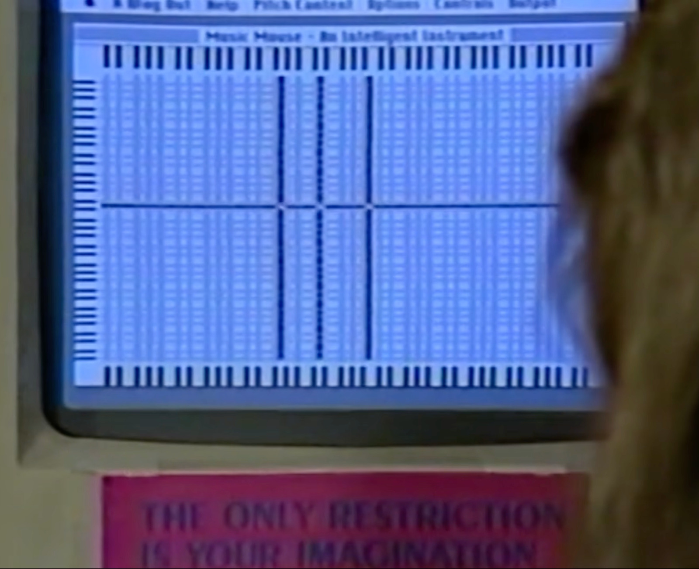

# MusicSnake

> *"The only restriction is your imagination."*

Instrumento generativo web. Cruce entre el Snake del Nokia y *Music Mouse: An Intelligent Instrument* de Laurie Spiegel (1986).

Una víbora que toca música polifónica a 4 voces en tiempo real: su cabeza controla soprano y alto (ejes X / Y del movimiento), el punto medio del cuerpo el tenor, la cola el bajo. Cada paso en la grilla genera un evento armónico. A medida que la víbora crece, se desbloquean voces nuevas — arranca en 1 segmento sonando soprano sola y llega a cuarteto completo.

**Jugar en vivo:** [vlasvlasvlas.github.io/musicsnake](https://vlasvlasvlas.github.io/musicsnake)

---

## Modos

- **Auto** — la víbora se mueve sola. Cuatro comportamientos autónomos: Busca-notas (harmonic seeker), Lissajous, Deriva Browniana, Sigue el mouse.
- **Juego** — la dirigís con flechas, WASD, swipe en mobile, o el mouse sobre el canvas.

---

## Features

### Crecimiento como curva armónica
La víbora empieza en 1 píxel con una sola voz (soprano). Al comer orbes crece, y a los 2, 4 y 8 segmentos se suman alto, tenor y bajo. Las dos voces humanas (cabeza XY) entran primero; las dos voces de Spiegel (contrapunto en el cuerpo, drone en la cola) se ganan al crecer.

### Los 10 patterns de Music Mouse
Las secuencias canónicas que Spiegel incluía en MM (10-note cycle, 6-note triadic arpeggio, 14-note scale, etc) se superponen al pitch derivado del movimiento como un offset cíclico de grados de escala. Combinable con simetría paralela o contraria.

### Tratamiento contrapuntístico
5 modos a la Spiegel: Movimiento contrario, Paralelo (quintas), Espejo, Cluster denso, Canon / Eco.

### Escalas
Pentatónica mayor/menor, Dórico, Lidio, Mixolidio, Eólico, Hirajōshi (koto japonés), Insen (shakuhachi), Whole-Tone (Debussy), Blues hexatónica, Cromática libre.

### Arpegiadores y dinámica
- Dos tempos alternables con `Tab` (saltás live entre lento y rápido sin arrastrar sliders)
- Articulación: Staccato, Half Legato, Full Legato (sostenido)
- Group: todas las voces se disparan juntas cuando una cambia (textura densa estilo coral)

### Modulación por longitud
Mientras la víbora crece, el filtro se abre, la reverb se expande, el delay se profundiza — sin tocar un slider. El sonido "crece" con el cuerpo.

### Pantalla Nokia + reflejos Spiegel
Estética LCD verde fósforo (Nokia 1100). Encima, columnas y filas de la grilla se iluminan en verde más claro cuando una voz está sonando — la traducción Nokia-nativa del principio *"around the edges of the display are pictures of keyboards and these lines point toward the current note"* de Spiegel.

### Freeze / sustain
Mantenés click sobre el canvas y la víbora se queda quieta; el acorde actual sostiene (como un pedal de piano). Doble click la deja congelada en modo latch. Doble tap en mobile hace lo mismo.

### Muda de piel
Chocar la pared o la cola en modo clásico no es Game Over: la víbora se reduce a 1 segmento, la música sigue sonando, y re-empezás a crecer. *"The way to keep it silent is to just not play it"* (Spiegel, 1986).

### Bancos de sonido para los orbes
Al comer un orbe elegís el timbre del pickup entre:
- **Sinte analógico** — Juno-style pluck filtrado (default)
- **Arcade** — sweep clásico 8-bit
- **FM** — campana DX7

### MIDI Out
Soporte Web MIDI API. Conectás MusicSnake a cualquier DAW o synth externo y la víbora genera MIDI mientras se mueve.

---

## Presets

- **Music Mouse (default)** — pentatónica C, movimiento contrario, pattern 6-note triadic, 110 BPM
- **Lydian Dreamscape** — lidia F, canon/eco, pattern 14-note scale, fullLegato, group on, 85 BPM
- **Berlin School Arp** — dórica A, paralelo, pattern 10-note cycle, staccato, 132 BPM (Tangerine Dream / Klaus Schulze)
- **Hirajōshi Zen Garden** — hirajōshi D, espejo, sin pattern, fullLegato, group on, 96 BPM
- **Acid Slither** — tonos enteros C, cluster, pattern 16-note irregular, staccato, 140 BPM

---

## Controles

**Teclado:**
- `Flechas` / `WASD` — dirección de la víbora
- `Space` — play / pause
- `Tab` — alternar Tempo 1 / Tempo 2
- `M` — mute
- `Q W E R T Y` — treatment (contrario / paralelo / espejo / cluster / canon)
- `1`–`8` — escala

**Canvas:**
- Mouse — guía la víbora
- Click-hold — freeze momentáneo (sustain)
- Doble click — freeze latch (toggle)
- Mobile: long-press = freeze, double-tap = latch, swipe = dirección

---

## Técnico

Vanilla JavaScript (ES modules), Web Audio API, Canvas 2D. Sin build step, sin dependencias runtime. Node 18+ para los tests de lógica (`npm test`).

Archivos principales:
- `js/music.js` — teorías de escala, voces, patterns, treatments
- `js/audio.js` — sintetizador Web Audio, bancos de timbres, articulación, MIDI
- `js/snake.js` — modelo y navegación autónoma de la víbora
- `js/app.js` — orquestador: reloj, tick pipeline, event handlers
- `js/renderer.js` — Canvas 2D, LCD Nokia, reflejos de voces
- `js/growth.js` — mapeo longitud → voces activas, curvas tímbricas

Documentación de diseño: `docs/superpowers/specs/2026-11-22-spiegel-first-sound-deepening-design.md`

---

## Para compartir

> MusicSnake: una víbora en el navegador que toca música. Cada paso en la grilla es una nota; cada orbe que come suma una voz hasta llegar a cuatro. Mecánica del Snake del Nokia, lógica musical de Music Mouse (Laurie Spiegel, 1986). Juega sola o la manejás. JavaScript, sin dependencias, corre en cualquier navegador.

---

## Créditos

Homenaje a [**Laurie Spiegel**](https://retiary.org/ls/) y su *Music Mouse: An Intelligent Instrument* (1986) — software histórico que convertía el cursor del Mac en instrumento polifónico inteligente.

Spiegel es también la compositora de *Kepler's Harmony of the Worlds*, la pieza incluida en el Golden Record de las Voyager que viaja hoy por el espacio interestelar.

Guía oficial de Music Mouse (Eventide): `docs/Music-Mouse-User-Guide-v1.0.1.pdf`

[Wikipedia: Music Mouse](https://en.wikipedia.org/wiki/Music_Mouse)
